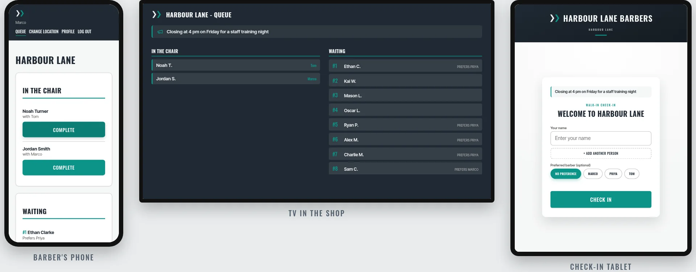

<p align="center">
  
</p>

<p align="center"><strong><a href="https://nextup.demo.feisar.xyz">Try the live demo</a> · <a href="https://feisar91.github.io/next-up/">Guides, screenshots and a demo video</a></strong></p>

# Next Up

Walk-in check-in for barber shops. Customers put their name in on a tablet by the door, the queue shows on the shop TV, and barbers call people up from their phones. It runs one shop or several, with your own name, colours and logo, on a server you control.

To try it without installing anything, open the [live demo](https://nextup.demo.feisar.xyz): a made-up shop you can log in to as the owner or a barber, with a kiosk and TV to play with. Everyone shares it, and it starts again every hour.

## Quick start

You need [Docker](https://docs.docker.com/get-docker/). Download the two files Next Up needs and start it:

```bash
mkdir next-up && cd next-up
curl -fsSLO https://github.com/feisar91/next-up/releases/latest/download/docker-compose.yml
curl -fsSL -o .env https://github.com/feisar91/next-up/releases/latest/download/env.example
docker compose up -d
```

Open `http://localhost:8000` and create your admin login. The Admin page then walks you through adding your shop.

Logins only work over HTTPS by default. To try it at an `http://` address other than `localhost`, add `SESSION_COOKIE_SECURE=false` to `.env` and run `docker compose up -d` again.

Upgrade to a new release with `docker compose pull && docker compose up -d`.

## More

- [Install and set up](https://feisar91.github.io/next-up/getting-started/): the full walkthrough, from install to a working kiosk and TV
- [Putting it online](https://feisar91.github.io/next-up/guides/server/): a server, a web address and HTTPS
- [Backups and upgrades](https://feisar91.github.io/next-up/guides/maintenance/)
- [How it works](docs/technical/how-it-works.md) and [Development and releases](docs/technical/development.md)
- [Roadmap](ROADMAP.md)
